# Microsoft Entra ID & Microsoft 365 Identity Management Lab

Hands-on lab covering core identity and access management tasks in **Microsoft Entra ID** and the **Microsoft 365 admin center**: creating users, building groups, assigning licenses, delegating admin roles, and applying least privilege.

> **Note:** Tenant name, domain, tenant/object IDs, user names, emails, and passwords have been redacted from all screenshots and from the short demo clips (GIF/MP4).

---

## Skills Demonstrated

- Creating and managing cloud-only users in Entra ID
- Creating **Security** and **Microsoft 365** groups (assigned membership)
- Assigning licenses to a group from the Microsoft 365 admin center and verifying them in Entra ID
- Assigning directory roles to users
- Using **Administrative Units (AUs)** to scope admin permissions
- Applying the **principle of least privilege**
- Understanding assigned vs. dynamic group membership and **SCIM** provisioning

---

## Lab Environment

| Item | Detail |
|---|---|
| Identity platform | Microsoft Entra ID (P2 trial) |
| Admin portals | Entra admin center, Microsoft 365 admin center |
| Tenant type | Cloud-only (Entra Connect not enabled, no sync) |
| Starting state | 4 users, 2 groups, 0 applications, 0 devices |

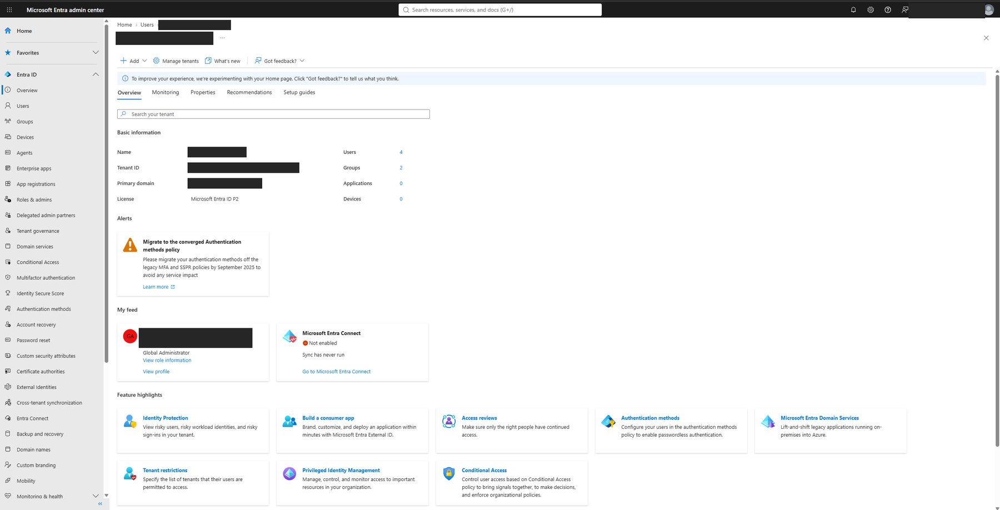

---

## 1. Creating Users

Users were created in **Entra ID > Users > Create new user**, setting the user principal name, display name, and an initial password, with the account enabled.

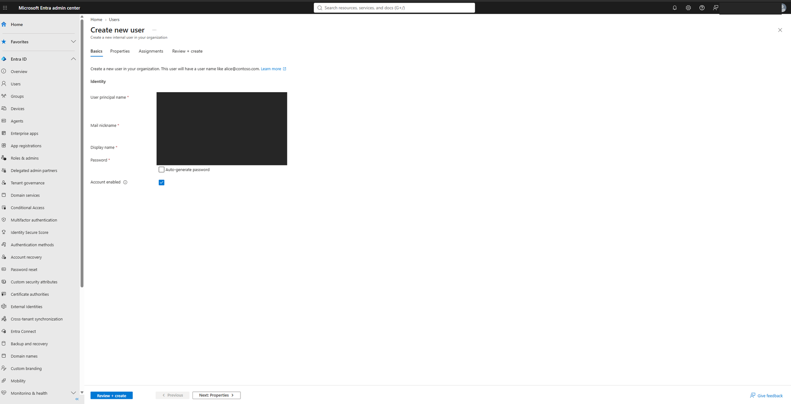

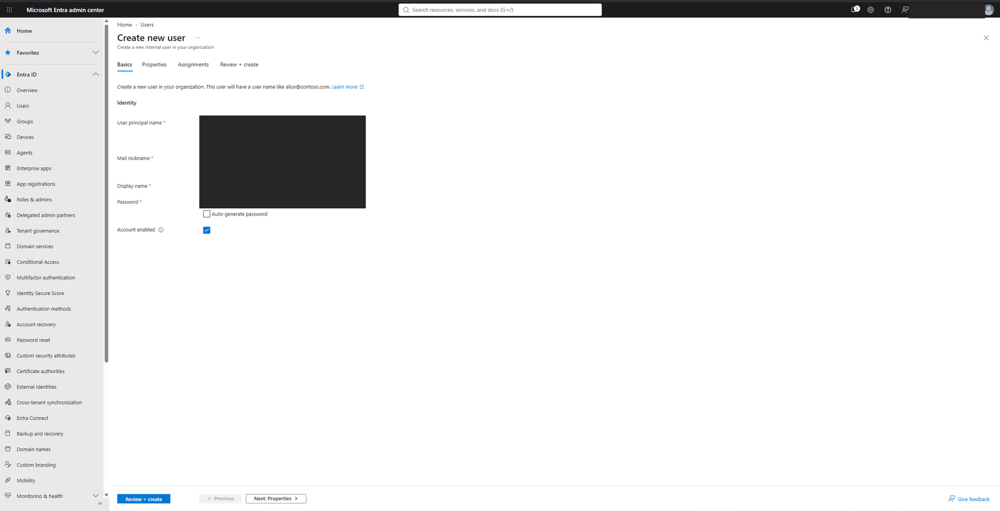

**Demo (redacted):**

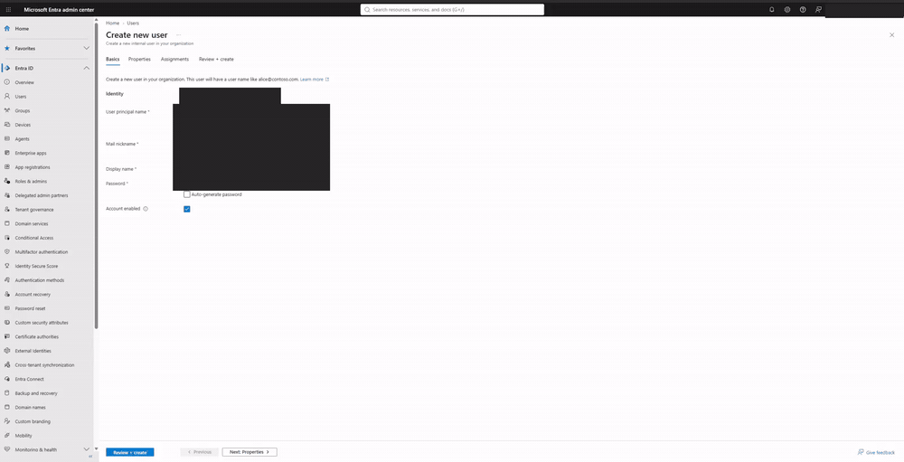

[MP4 version](videos/clips/creating-user-redacted.mp4)

---

## 2. Creating Groups

### Security group (Marketing)
A **Security** group with **Assigned** membership, used here as the target for license assignment.

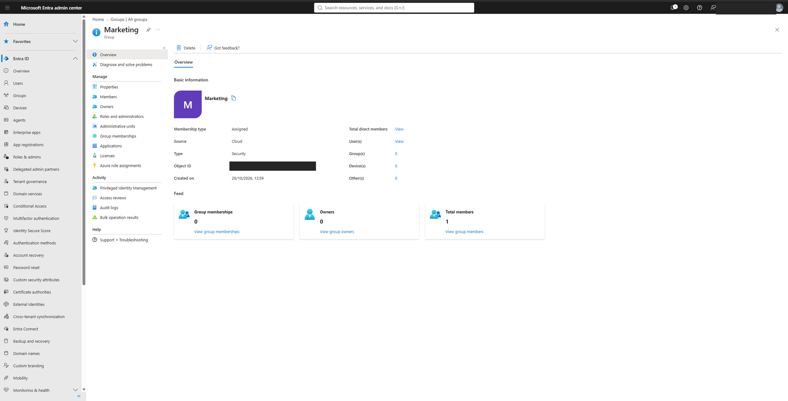

### Microsoft 365 group (Northwest Sales)
A **Microsoft 365** group with a group email address, an owner, and members selected through the *Add members* panel.

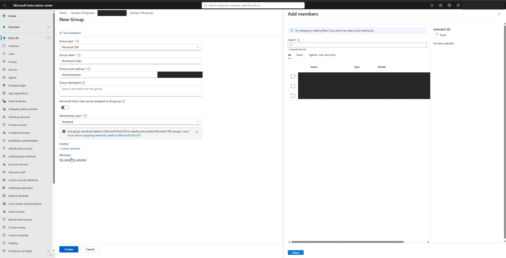

**Demo (redacted; the owner/member picker panel is masked):**

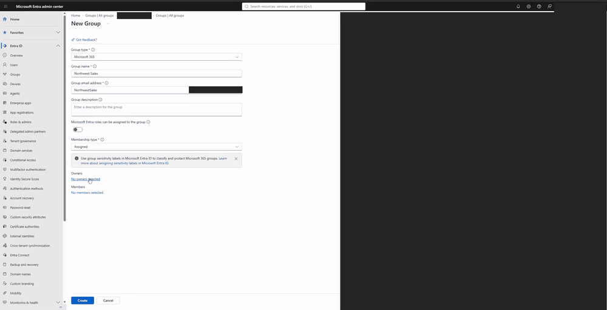

[MP4 version](videos/clips/creating-m365-group-redacted.mp4)

---

## 3. Assigning Licenses

Licenses were assigned in the **Microsoft 365 admin center** (Billing > Licenses), not in Entra ID. Entra ID is used to **verify** the result, because license add/remove is only available in the M365 admin center.

1. Open **Billing > Licenses** and select the Microsoft Entra ID P2 subscription.
2. Choose **Assign licenses** and pick a group (here, *Marketing*) or user.
3. Select the subscription and the apps/services to enable, then assign.

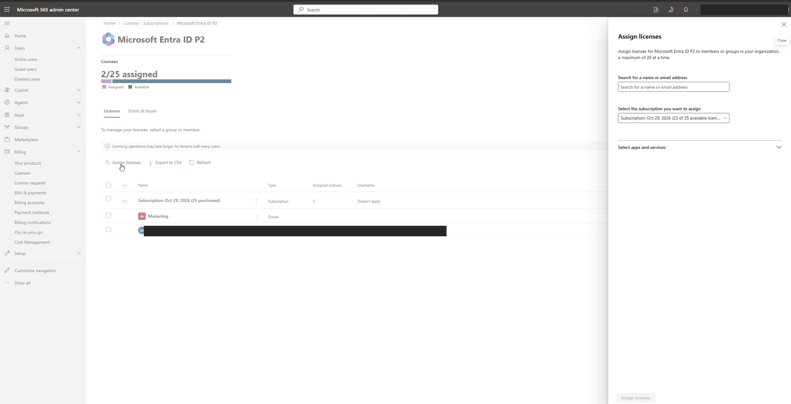

**Demo (redacted):**

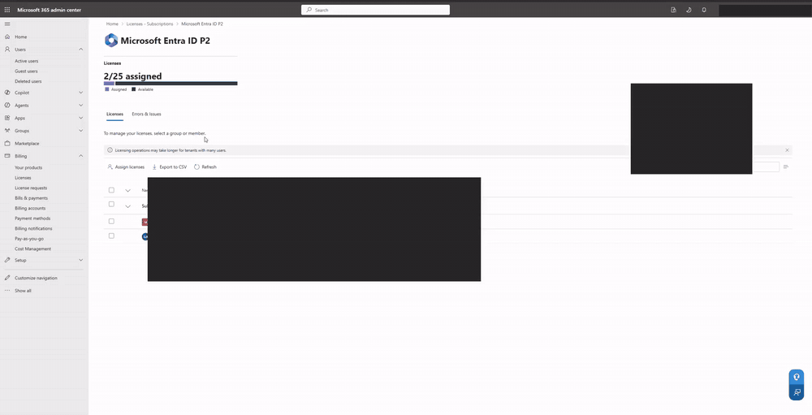

[MP4 version](videos/clips/assigning-licenses-redacted.mp4)

### Verifying in Entra ID
On the user's **Licenses** blade, the product shows as **Active** with **4/4** services enabled. The assignment path indicates how the license was applied.

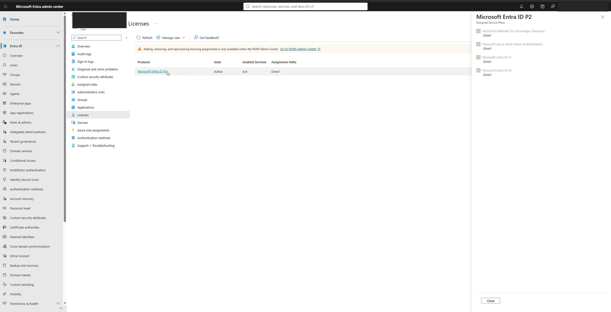

---

## 4. Assigning Roles

Roles were assigned from **Entra ID > Users > (user) > Assigned roles > Add assignments**, which opens the directory role list (Groups Administrator, Helpdesk Administrator, License Administrator, and so on).

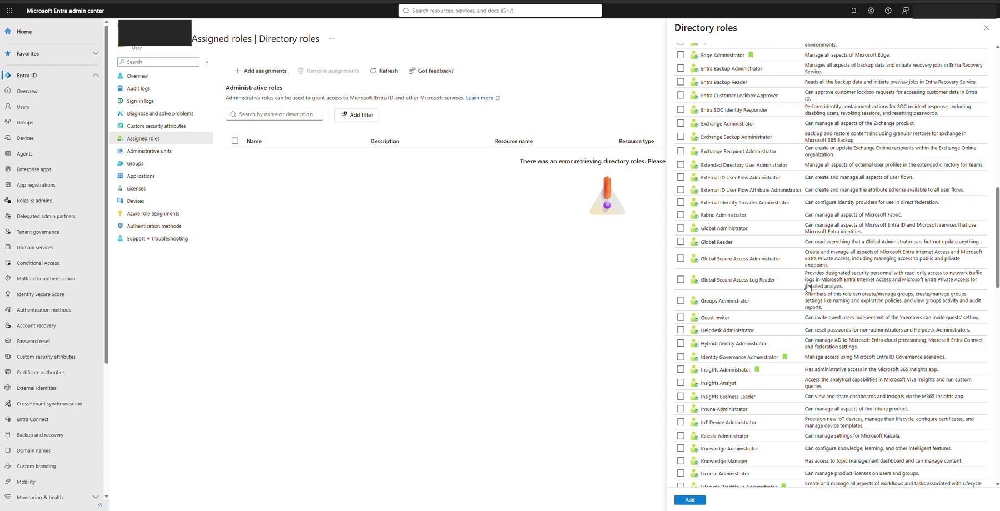

**Demo (redacted):**

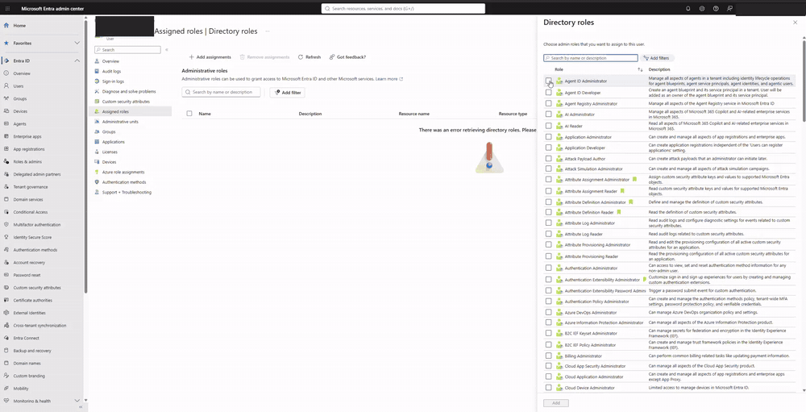

[MP4 version](videos/clips/assigning-roles-redacted.mp4)

---

## Key Concepts

### Administrative Units (AUs)
To let someone manage only a specific set of users or groups, create an **Administrative Unit**, add the users/groups to it, then assign that person an admin role **scoped to the AU**. This is the Entra ID equivalent of an **Organizational Unit (OU)** in on-prem Active Directory.

### Principle of least privilege
Give users only the rights, access, and permissions they need to do their job, nothing more. Prefer narrowly scoped roles (and AU-scoped assignments) over broad ones such as Global Administrator.

### Modifying permissions
- **User settings** in Entra ID control tenant-wide user behavior.
- **Add roles / role assignments** grant new permissions to users or groups.

### Group membership types

| Type | How it works | Example use |
|---|---|---|
| **Assigned** | Members are added and removed manually | Small teams, one-off access |
| **Dynamic** | Entra ID adds/removes members automatically based on user attributes (rules) | Location or department changes move users automatically |

### SCIM (System for Cross-domain Identity Management)
An open standard for **automating user and group provisioning and deprovisioning** between an identity provider (Entra ID) and applications. When a user is created, changed, or removed in Entra ID, SCIM keeps the connected app in sync.

---

## Key Takeaways

- License assignment lives in the **M365 admin center**; Entra ID is best for verification.
- Assigning licenses to **groups** scales better than assigning per user.
- **Dynamic groups** reduce manual admin work; **AUs** enable safe delegation.
- Always start from least privilege and add access only when needed.

---

## Media Index

| Topic | Screenshot(s) | Redacted demo |
|---|---|---|
| Creating users | `01`, `02` | [GIF](videos/clips/creating-user-redacted.gif) |
| Creating groups | `03`, `08` | [GIF](videos/clips/creating-m365-group-redacted.gif) |
| Assigning licenses | `06`, `09` | [GIF](videos/clips/assigning-licenses-redacted.gif) |
| Assigning roles | `07` | [GIF](videos/clips/assigning-roles-redacted.gif) |
| Tenant overview | `05` | n/a |

---

## Repository Structure

```
entra-id-lab/
├── README.md
├── images/                      # 8 redacted screenshots
│   ├── 01-create-user-1.png
│   ├── 02-create-user-2.png
│   ├── 03-security-group-marketing.png
│   ├── 05-tenant-overview.png
│   ├── 06-assign-licenses-m365.png
│   ├── 07-add-directory-roles.png
│   ├── 08-create-m365-group.png
│   └── 09-verify-license-in-entra.png
└── videos/
    └── clips/                   # redacted GIF + MP4 demos
        ├── creating-user-redacted.(gif|mp4)
        ├── creating-m365-group-redacted.(gif|mp4)
        ├── assigning-licenses-redacted.(gif|mp4)
        └── assigning-roles-redacted.(gif|mp4)
```
